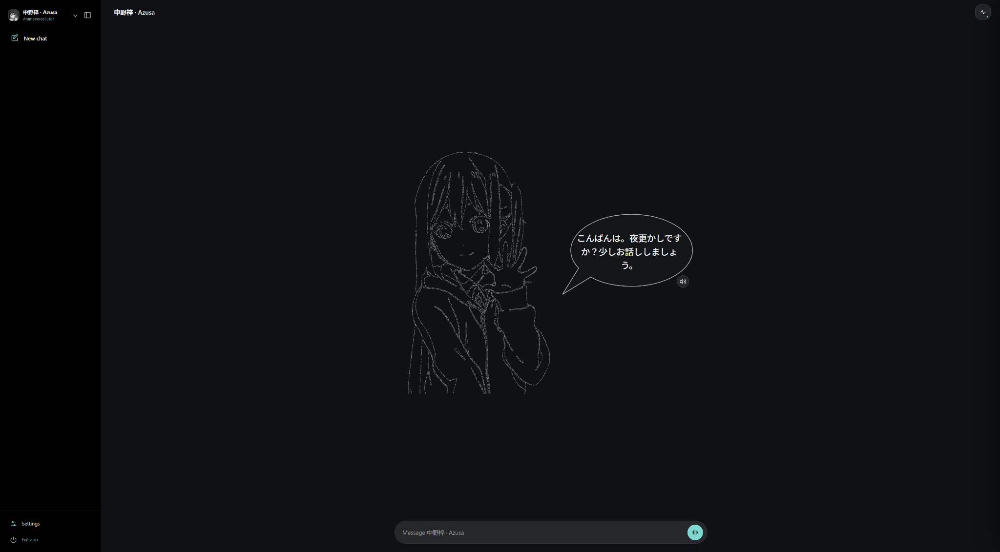

# AnimeVoiceTutor

**Give AI conversations distinctive anime character voices for a more natural character chat experience.**

English | [简体中文](README.zh-CN.md) | [日本語](README.ja.md)

AnimeVoiceTutor is an open-source, self-hosted **AI character chat application**. Install a character voice pack to chat with an AI character using text or your microphone and hear responses in that character's voice. The application combines configurable AI providers with local Qwen3-ASR speech recognition and GPT-SoVITS voice synthesis.

## Available Characters — Azusa Nakano (中野 梓)

**K-ON! / けいおん！** · Azusa character voice pack v1 · Japanese voice

Experience an Azusa-themed AI conversation with a character greeting, a dedicated voice, and real-time speech synthesis. [Find the character pack in Releases](https://github.com/Bocch1/AnimeVoiceTutor/releases).



> **Standalone Model Weights:** If you only need the GPT-SoVITS model weights, visit [Hugging Face](https://huggingface.co/oumaerin/AnimeVoiceTutor-Azusa-v5turbo). These weights are intended for compatible GPT-SoVITS environments and are not complete AnimeVoiceTutor character packs.

*Actual application welcome screen featuring the Azusa character pack. Unofficial fan-made character experience.*

## Features

- **Character voice packs:** download and install AnimeVoiceTutor character ZIPs, then switch between installed characters.
- **AI conversations:** connect a supported AI provider using your own API credentials.
- **Voice chat:** speak through the microphone, transcribe speech locally, and listen to generated character responses.
- **Character interface:** portraits, greetings, conversation history, and multilingual controls.
- **Local deployment:** run the Web UI, ASR and TTS components on your own computer.
- **Three interface languages:** English, Simplified Chinese, and Japanese.

## Install and start (Windows)

1. From [GitHub Releases](https://github.com/Bocch1/AnimeVoiceTutor/releases), download and extract **`AnimeVoiceTutor_Core_v0.13.1.zip`** to a writable folder.
2. Double-click **`First Run Setup.cmd`** to **install the voice environment and verify it using Diagnostics**. The language selector always reads **Language**; **Advanced options** allows supported local engine/model paths.
3. From the **Release Assets**, download an **AnimeVoiceTutor character ZIP** (when one is available). Install it in **First Run → Step 2**, or import that ZIP later in the Web UI.
4. Double-click **`Start AnimeVoiceTutor.cmd`**, configure your AI provider in **Settings**, and start chatting. Choose **Exit application** in the Web UI when finished; `Stop AnimeVoiceTutor.cmd` is a fallback.

**Character packages are specific to AnimeVoiceTutor.** A standalone `.pth` weight file is not a complete character package and cannot be imported directly. Each full voice package needs its metadata, reference audio, voice settings, and matching model files. The Core download does not include character voices or third-party character media.

The application is designed primarily for **Windows 10/11 x64 with NVIDIA GPU support**. Compatibility may vary depending on hardware, drivers, and system configuration. An internet connection is needed for initial dependency/model downloads. See [Installation](docs/INSTALLATION.md) for requirements and troubleshooting.

## Everyday use

| Double-click | Purpose |
| --- | --- |
| `First Run Setup.cmd` | Install and diagnose the voice environment; download/import a character ZIP |
| `Start AnimeVoiceTutor.cmd` | Launch the application without keeping a console open |
| `Stop AnimeVoiceTutor.cmd` | Stop this installation's managed services if the Web exit is unavailable |

Normal use does not require PowerShell commands. Development and diagnostic tools are in [`advanced/`](advanced/). Spaces in `.cmd` filenames are supported.

## Local package folders

```text
packages/
  updates/       AnimeVoiceTutor_Core_v0.13.1.zip
  characters/    AnimeVoiceTutor_Character_<id>_v<version>.zip
```

Character ZIP archives are saved in `packages/characters/` after import. Installed model files remain in `data/character_packs/`. The `packages/` directory and local models are excluded from the public Core source. See [Local packages](docs/LOCAL_PACKAGES.md).

## Documentation

- [Installation and troubleshooting](docs/INSTALLATION.md)
- [Character package format](docs/CHARACTER_PACKS.md)
- [Local package folders](docs/LOCAL_PACKAGES.md)
- [Testing](docs/TESTING.md)
- [Publishing](docs/PUBLISHING.md)

## Fan project, licenses and rights

AnimeVoiceTutor is an **independent, unofficial fan-made project developed for non-commercial purposes**. It is not affiliated with or endorsed by anime studios, publishers, character owners, or voice actors. Original characters, artwork, voice recordings, trademarks, and other third-party material remain the property of their respective rights holders.

The application's original **source code is MIT-licensed**; this does not grant rights to third-party characters or audio. The MIT code license has its own terms and is not a non-commercial-only license. Rights-holder concerns can be raised through the [repository](https://github.com/Bocch1/AnimeVoiceTutor/issues); substantiated requests will be reviewed promptly and affected material removed when appropriate. **A takedown notice does not replace permission to distribute third-party material.** See [Third-party notices](THIRD_PARTY_NOTICES.md) and [Security](SECURITY.md).
