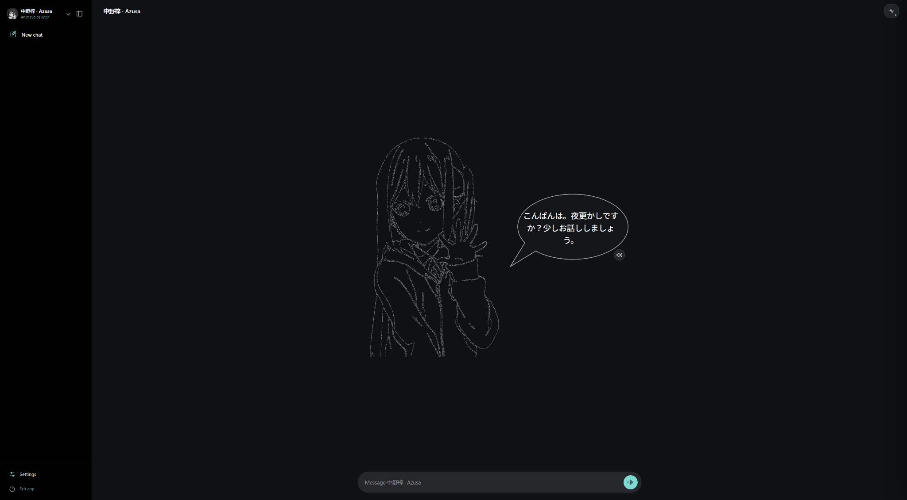

# AnimeVoiceTutor

**让 AI 对话拥有专属动漫角色声音，体验更加自然的人物对话。**

[English](README.md) | 简体中文 | [日本語](README.ja.md)

AnimeVoiceTutor 是一款开源、本地部署的 **AI 角色对话程序**。安装人物语音包后，即可通过文字或麦克风与 AI 角色交流，并听到人物专属的合成语音。程序支持自定义 AI 服务，并结合本地 Qwen3-ASR 语音识别与 GPT-SoVITS 语音合成。

## 当前角色 — 中野梓（Azusa Nakano）

**《轻音少女》/ K-ON! / けいおん！** · Azusa 人物语音包 v1 · 日语语音

通过 Azusa 主题人物语音包，体验专属问候语、人物声音与实时 AI 语音对话。[从 GitHub Releases 获取人物包](https://github.com/Bocch1/AnimeVoiceTutor/releases)。



*实际运行中的 Azusa 人物欢迎页面。此为独立非官方同人项目展示。*

## 主要功能

- **人物语音包：** 下载并安装 AnimeVoiceTutor 专用人物 ZIP，在已安装的角色之间切换。
- **AI 对话：** 配置受支持的 AI 服务和自己的 API Key，与角色交流。
- **语音互动：** 麦克风输入、本地语音识别和角色语音回复。
- **角色界面：** 人物立绘、问候语、聊天记录及多语言操作界面。
- **本地运行：** 在自己的电脑上运行 Web、ASR 和 TTS 组件。
- **三语言界面：** 简体中文、英语、日语。

## 安装与启动（Windows）

1. 从 [GitHub Releases](https://github.com/Bocch1/AnimeVoiceTutor/releases) 下载 **`AnimeVoiceTutor_Core_v0.13.1.zip`**，将整个 ZIP 解压到可写入的文件夹。
2. 双击 **`First Run Setup.cmd`**，**安装语音环境并通过“环境诊断”检查安装结果**。语言入口始终显示 **Language**；需要复用本机已有模型或引擎时可展开**高级选项**。
3. 从 **Release 附件**下载 **AnimeVoiceTutor 专用人物 ZIP 包**（若该版本已提供），在 **First Run 第二步**下载并安装或选择本地 ZIP 导入；以后也可以从网页界面导入。
4. 双击 **`Start AnimeVoiceTutor.cmd`** 启动程序，在**设置**中配置自己的 AI 服务，然后开始对话。结束时点击网页中的**退出应用**；必要时使用 `Stop AnimeVoiceTutor.cmd`。

**人物包使用 AnimeVoiceTutor 专用格式。** 单独的 `.pth` 权重不是完整角色包，不能直接导入；完整语音包还需包含角色信息、参考音频、推理配置及匹配的模型文件。Core ZIP 不附带动漫人物语音或第三方人物素材。

程序主要面向 **Windows 10/11 x64 与 NVIDIA GPU 环境**。实际兼容性可能因硬件、驱动与系统配置而有所不同。首次下载安装依赖与模型需要网络。详细要求与故障排查见 [安装说明](docs/INSTALLATION.md)。

## 日常使用

| 双击文件 | 用途 |
| --- | --- |
| `First Run Setup.cmd` | 安装、诊断语音环境；下载或导入人物 ZIP |
| `Start AnimeVoiceTutor.cmd` | 启动程序，无需保持控制台运行 |
| `Stop AnimeVoiceTutor.cmd` | 网页退出不可用时，停止本次安装管理的服务 |

日常使用不需要运行 PowerShell 命令。开发、诊断和测试工具放在 [`advanced/`](advanced/)；CMD 文件名中的空格不影响使用。

## 本地安装包归档

```text
packages/
  updates/       AnimeVoiceTutor_Core_v0.13.1.zip
  characters/    AnimeVoiceTutor_Character_<id>_v<version>.zip
```

成功导入的人物 ZIP 会存入 `packages/characters/`；实际使用的模型仍在 `data/character_packs/`。`packages/` 和本地模型不会进入公开 Core 包。详见 [本地文件夹说明](docs/LOCAL_PACKAGES.md)。

## 更多说明

[安装与故障排查](docs/INSTALLATION.md) · [人物 ZIP 格式](docs/CHARACTER_PACKS.md) · [本地归档](docs/LOCAL_PACKAGES.md) · [测试说明](docs/TESTING.md) · [发布说明](docs/PUBLISHING.md)

## 非官方同人项目与权利声明

AnimeVoiceTutor 是**独立、非官方、以非商业目的开发的同人项目**，不代表任何动画制作公司、出版社、角色权利人或配音演员，也未获得其官方背书。原始角色、立绘、录音、商标等第三方内容的权利归各自权利人所有。

程序原创**源代码采用 MIT 许可证**，但该许可证不包含第三方角色或音频的分发许可；MIT 代码许可本身也不限制商业再利用。权利人如对项目内容有异议，可通过 [GitHub 仓库](https://github.com/Bocch1/AnimeVoiceTutor/issues) 联系维护者。有效权利请求将得到及时审查，必要时删除相关内容。**“收到投诉后删除”的声明不能代替第三方素材的使用或分发授权。** 详见 [第三方声明](THIRD_PARTY_NOTICES.md) 与 [安全说明](SECURITY.md)。
